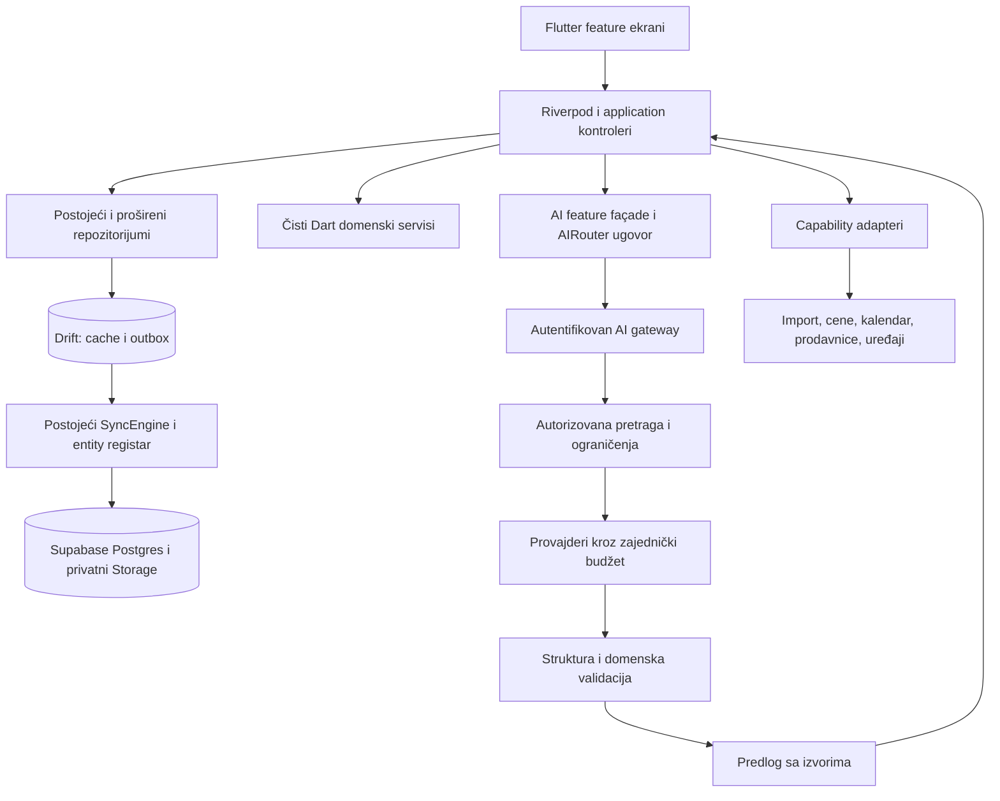

# Tavli Next — arhitektura za 90 proširenja

Datum: 9. novembar 2026. Status: **predložena arhitektura; proširenja nisu implementirana ovim dokumentom**.

Osnova: [anjahubac/tavli](https://github.com/anjahubac/tavli), commit `1eca2c3d14fb5dd9b25a42958aa018c8d8dfbb94`. Originalni kod, istorija i prethodne specifikacije ostaju sačuvani. Nova istraživanja su u `research/`, detaljan redosled u [tasks/plan.md](tasks/plan.md), svih 90 ID-jeva u [registru](research/feature-register.json).

## 1. Šta postoji i šta se nadograđuje

| Oblast | Posmatrana osnova | Odluka |
|---|---|---|
| Prikaz/stanje | Flutter, Riverpod, go_router; `lib/providers.dart`, `lib/app/router.dart` | Zadržati jednu aplikaciju i postojeće feature komponente. |
| Recepti | `RecipeRepository`, fotografije, AI preview, izmene i istorija | Jedan izvor recepata; novi importeri koriste isti pregled i čuvanje. |
| Planiranje | `MealPlanAI`, nacrti, approval/fingerprint, kalendar i snimci recepata | Proširiti postojeće operacije i snimke, ne paralelni planer. |
| Količine | `shopping_demand.dart`, `supply_allocation.dart`, fiksna preciznost | Jedan deterministički obračun za plan, ostavu i nabavku. |
| Lokalni podaci | Drift, schemaVersion 5 u posmatranoj verziji | Aditivne migracije; sledeću verziju odrediti tek pri implementaciji. |
| Server | Supabase Auth, Postgres RLS, privatni Storage | Zadržati naloge, vlasništvo i privatne fotografije. |
| Sinhronizacija | Repozitorijum → lokalni red + outbox, Uploader/Downloader/PhotoSync | Svaki novi korisnički entitet ulazi u isti registar i cleanup. |
| AI | AIRouter, više modela, retry/cooldown, direktan HTTP i build-time ključevi | Postojeći direktni model je baseline; cilj za zajedničke ključeve je autentifikovan serverski gateway. |

README/roadmap originala delimično zaostaju za kodom. Merodavni su tačno posmatrani moduli i testovi, ne oznaka „planned” iz starog dokumenta. Specifikacija 010 ima implementirane delove, ali otvorene završne/UX zadatke.

## 2. Ciljna struktura

Dijagram prikazuje cilj, ne postojeće mrežne granice. Backend lokacija AI gateway-a bira se ADR-om posle merenja: Supabase Edge Function kao početni kandidat, duži poslovi u ograničenom worker-u samo ako runtime limiti to zahtevaju. Ne uvoditi odvojene mikroservise po funkciji.

## 3. Moduli i vlasništvo

| Stream | Odgovornost | Postojeći oslonci |
|---|---|---|
| A | AI, pretraga, ingest, relevantnost i izvori | `lib/ai/`, `lib/features/recipes/`, `recipe_repository.dart` |
| B | Plan, kalendar, scenariji, ostaci | `meal_plan.dart`, `plan_calendar.dart`, `meal_plan_repository.dart`, `features/planning/` |
| C | Ostava, količine, računi i zalihe | `pantry_repository.dart`, `shopping_demand.dart`, `supply_allocation.dart` |
| D | Nabavka, članstvo, finansije i trgovci | `shopping_repository.dart`, `account/`, `sync/` |
| E | Kuvanje, tajmeri, govor, edukacija i uređaji | `recipe_view.dart`, `keep_screen_on.dart`, postojeći theme i animations |
| F | Prenosivost, provera recepata, javno deljenje i platforma | `Recipe`, `RecipeVersion`, `account_service.dart`, postojeći storage/sync ugovori |

Streamovi su granice istraživanja i budućih feature grana, ne šest aplikacija. `lib/providers.dart`, `database.dart`, `database.g.dart`, router, sync registar i migracije imaju jednog integracionog vlasnika. Njihove izmene idu redom nakon dogovora o ugovoru.

## 4. Obavezne domenske invarijante

1. Odobreni plan koristi snimak verzije recepta. Kasnija izmena biblioteke ne menja tiho već planiranu nabavku.
2. Potražnja je vezana za konkretnu pripremu/obrok i njegove porcije. Ponavljanje istog recepta nije duplikat potražnje.
3. Kupljena namirnica i njen prijem u ostavu imaju zajednički identitet fizičke zalihe. Zaliha se ne kreditira dvaput.
4. Nepoznato nije nula. Nepoznata količina, cena, alergen, nutritivni ili ekološki podatak ostaju eksplicitno nepoznati.
5. Mase i zapremine se ne pretvaraju bez potvrđenog faktora za konkretnu namirnicu. Sinonim naziva ne dokazuje fizičku zamenljivost.
6. Količine nastavljaju postojeći fixed-point obračun. Novac je celobrojni broj najmanjih jedinica valute uz obavezan kod valute; nema sabiranja različitih valuta bez datirane konverzije.
7. Predlog nije upis: AI plan, import, račun, zamena, kupovina i uređaj imaju eksplicitnu potvrdu tamo gde menjaju stanje/spoljni svet.
8. Izmena lokalnog reda i outbox-a je atomska; mreža nije deo SQLite transakcije. Ponovljen zahtev sa istim identitetom ne duplira rezultat.
9. Svaki upit/upis ima `AccountScope` i aktivno domaćinstvo. Pretraga i vektorski indeks primenjuju vlasništvo pre rangiranja, ne tek posle odgovora modela.
10. Delete-wins i postojeće tombstone ponašanje ostaju kompatibilni. Nove finansijske/inventarske operacije imaju svoj plan konflikata; realtime obaveštenje nije algoritam za rešavanje konflikta.

## 5. Ciljni podaci — predlozi, ne SQL koji je primenjen

| Agregat | Predloženi dodatak | Pravilo |
|---|---|---|
| Recipe | provenance/source locator, canonical ingredient IDs, stable step/ingredient IDs, equipment, evidence status | Ne menjati postojeće ID-jeve niti stare verzije bez migracionog adaptera. |
| Dietary constraints | lični profil + eksplicitni uslovi plana | Alergije nisu slobodan tekst „želja”; nepoznati sastojci se ne odobravaju kao sigurni. |
| Recipe evidence | `recipeVersionId`, izvor/timestamp/page, vrsta podatka, reviewer/test context | AI procena i izmereno/testirano su odvojeni statusi. |
| Pantry lot | proizvod, lokacija, potvrđena količina, rok, openedAt, receipt/source identity | Lotovi mogu imati različite rokove; potvrđeno stanje je datirano. |
| Stock event | priprema/utrošak/kupovina/korekcija/bacanje/transfer, operation ID | Događaji imaju idempotentnost i kompatibilnost sa postojećim supply ledger-om; ne praviti drugi obračun. |
| Meal plan | constraints snapshot, event kinds, leftovers link, template/scenario, undo event | Jedan cooking source može hraniti više consumption slotova. |
| Commerce | product/barcode/package, datirana cena, uslovi promocije, coverage, receipt mapping | Jedinična cena i cena pakovanja odvojene; nepotpune korpe nisu uporedive kao potpune. |
| Household | članstvo, uloge, aktivni scope, invite lifecycle, assignment | Prava proverava server; promene scope-a invalidiraju nacrte i cache selekcije. |
| Cooking | session, timers, measurements, cook log, step state | Monotonic intervali za tajmere, kalendarski/UTC podaci za istoriju; wake lock pravilno oslobođen. |
| Finance | purchase/expense, payer, beneficiaries, minor-unit splits, settlement | Zbir raspodela tačno jednak trošku; lične stavke ne raspodeljivati implicitno. |
| Portability | verzionisana arhiva, manifest, hash, mapiranje ID-jeva, restore job | Prvo validacija bez upisa, zatim kontrolisana obnova i provera izolacije. |

Detaljni predlozi tabela i funkcija u stream izveštajima su kandidati. Integracija bira jedan kanonski model i objavljuje ADR pre bilo koje migracije. Migracije se ne pišu konkurentno.

## 6. AI tok i izvori

`action → scope/auth → typed constraints → autorizovana pretraga → kandidati sa ID/verzijom → model → strukturni parser → deterministička domenska provera → pregled → potvrda → repozitorijum`.

- Prvi korak: ispraviti gubitak `request.wishes` između outline-a i generisanja sažetaka. Zatim uvesti tipizovana ograničenja kroz isti tok.
- Relevantnost nije `library.take(60)`. Najpre deterministički filteri i pretraga preko postojeće zbirke, opcioni embedding tek ako benchmark pokaže korist.
- Model ne računa količine, novac, prava pristupa, formule hidratacije ili geometriju kalupa.
- Gateway proverava JWT i ovlašćenje za konkretno domaćinstvo. Model ne bira proizvoljan household ID niti izvršava proizvoljne URL-ove/alate.
- Jedan ukupan deadline, attempt/token/request budžet i cancellation ID obuhvataju ceo fallback lanac i sve podkorake; limit se ne resetuje promenom modela.
- Zajednički ključevi ostaju serverski. Postojeći BYOK zahteva poseban ADR o prenosu/čuvanju; ne čuvati ih u običnoj bazi ili logovima.
- Import sa URL-a je serverski ograničen: protokol, redirect, javne adrese posle DNS provere, tip/veličina sadržaja, vreme i broj preuzimanja.
- Tekst iz PDF-a, skena ili videa je podatak. Ubuduće dozvoljeni alati imaju zatvoren ugovor i autorizaciju aplikacije.
- Izvori se vežu za verziju recepta i deo sadržaja; tvrdnja o količini mora imati izvor ili oznaku da je generisana/nepoznata.

## 7. Portovi za spoljne sisteme

Zajedničko stanje capability adaptera: `unconfigured | unavailable | permissionRequired | ready | degraded`. Korisnik vidi srpsku poruku i ručnu alternativu. Credentiali su u platform secure store-u ili server secret store-u, nikad u reference-code kolekciji.

| Port (predlog imena) | Granica odgovornosti |
|---|---|
| RecipeImportPort | ulazni dokaz → kandidat recepta + poreklo, bez samostalnog upisa |
| ProductCatalogPort / PricePort | proizvod/pakovanje, vreme provere, pokrivenost i valuta |
| ReceiptExtractionPort | kandidat kupovine sa vezama; korisnik potvrđuje stvarni upis |
| CalendarPort | odvojeni read-only ICS izlaz i optional free/busy ulaz; privatni link opoziv |
| RetailCartPort | proverene stavke + zamene → pregled; naručivanje ostaje potvrđena radnja |
| ScalePort / ThermometerPort / OvenPort | podržan model/protokol, očitavanje ili potvrđena komanda; manual fallback |
| NutritionPort / EnvironmentalPort | datirani izvor, jedinice, pokrivenost i metod; bez lažne preciznosti |
| ExportRestorePort / WebhookPort | scope, verzija, hash, idempotency, revocation; minimalni sadržaj događaja |

## 8. RLS, sinhronizacija i kompatibilnost

Svaki novi entitet ima: server RLS + eksplicitni grant, lokalno scope polje, registry mapping, parents redosled, tombstone/cleanup, migracioni test i dva naloga u pgTAP-u. Za stale update finansija ili zalihe razraditi revision/CAS ili server atomsku operaciju; običan upsert ne predstavlja dovoljno jamstvo.

Stari redovi su čitljivi kroz nullable/default adaptere; ne brisati bazu radi lakše migracije. Imena novih SQL migracija rezerviše integrator. Obnova arhive ne sme oživeti tuđe obrisane ID-jeve ili ponovo uploadovati stare tombstone-ovane podatke bez eksplicitnog pravila remapiranja.

## 9. Provere i merenje

- Domenski testovi sa unapred izračunatim količinama i novcem; property/invariant testovi gde imaju smisla.
- Parseri: nevalidni tipovi, višak/manjak polja, prazni kandidati, nepoznati ID/verzija, nepoznata količina i hostile tekst.
- Sinhronizacija: ponavljanje/slanje van redosleda, offline izmene dva uređaja, promena scope-a, brisanje roditelja, idempotentan račun/prijem.
- Migracije: baseline v5 → naredni korak → restore; bez ručnog menjanja generated koda.
- UI: 320/400/1200 px, text 2×, tastatura/fokus, reduced motion, offline/error/empty; zadržati postojeće animacije i wake lock.
- Integracije: lažni adapteri u CI; stvarni uređaji/sandbox kao zaseban dokaz kompatibilnosti, bez produkcijskog poziva u testovima.
- AI evaluacija: sintetički skup sa constraint violation rate, grounded ID/version accuracy, valid output rate, retrieval hit rate, latency i brojem pokušaja. Svako kršenje obaveznih ograničenja je neuspeh slučaja; test skup nije univerzalna garancija.
- Dokaz implementacije: commit + test komanda/rezultat + scenario; tek tada `implementation_verified=true`.

## 10. Reverse engineering i ponovna upotreba

Istraživanje rekonstruiše dostupne tokove iz javnog izvornog koda: tačan commit, putanja, simbol, ulaz/izlaz i ograničenja. Ne izvodi zaključak o runtime ponašanju samo iz README-a. `research/manifests/*.json` razlikuje posmatrani kod, naš predlog i nepoznato.

`research/reference-code/` je arhiva referentnih fajlova sa originalnim licencama i hash-evima, **nije deo Flutter build-a**. U ovom prolazu kopiraju se samo potvrđeni permisivni mali fajlovi; GPL/AGPL/custom/unlicensed se citiraju za obrazac, bez integracije koda. Originalni Tavli nema top-level licencu u posmatranom stablu; ne izmišljati licencu ni tvrditi pravo javnog relicenciranja. Repo ostaje privatni radni nastavak koji je korisnik zatražio.

## 11. Evidencija i dalji rad

- [Plan](tasks/plan.md): faze, granice i zavisnosti.
- [Task index](tasks/todo.md): po jedan pregledni unos za svaki od 90 predloga; detaljni mali koraci u stream izveštajima.
- [Detaljan feature plan](tasks/FEATURE-PLAN.md): svih 90 funkcija sa 273 predložene vertikalne celine, acceptance i proverama.
- [Šest radnih paketa](research/streams.json): tačno jedan vlasnik po feature ID-ju.
- [Integracioni ugovori](docs/expansion/CONTRACTS.md): zajednički modeli, vlasnici i očekivane referentne računice.
- [YouTube](research/YOUTUBE.md): pronađeni kandidati, nivo evidencije i korisni zaključci.
- [Poreklo](docs/expansion/UPSTREAM.md): original i pravila atribucije.
- [Provere blueprint-a](tools/verify_blueprint.py): pokrivenost, evidencija i hash-evi kopiranih fajlova.
