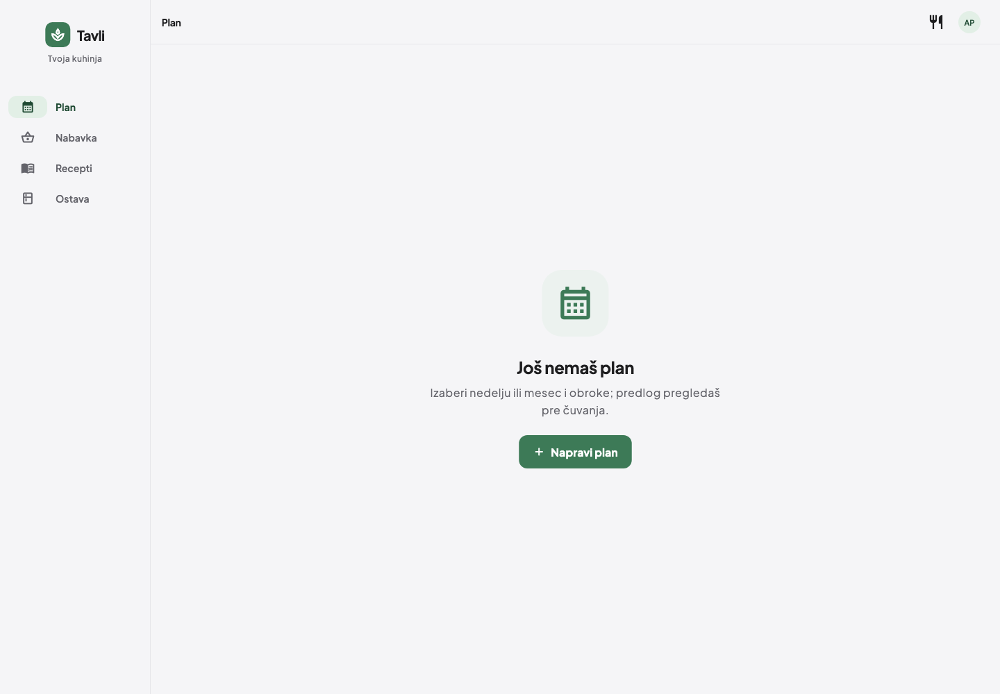
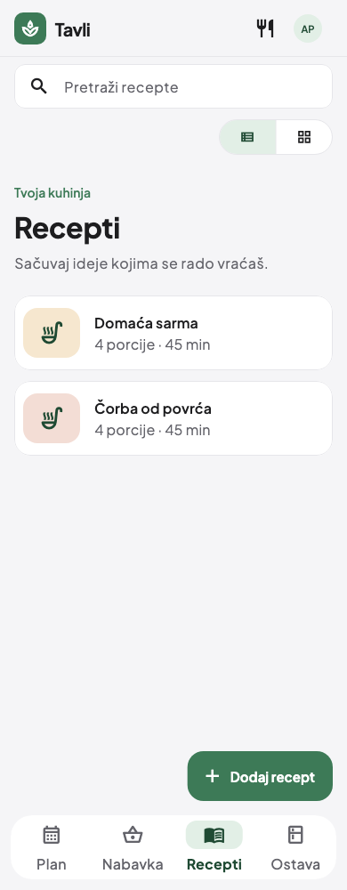
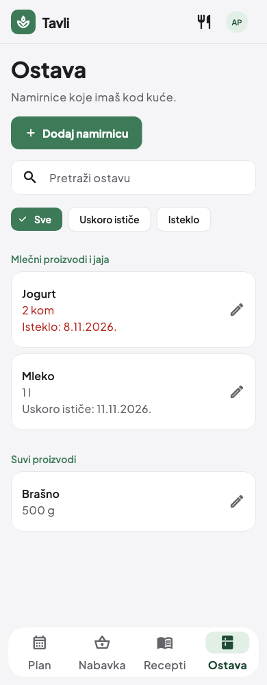
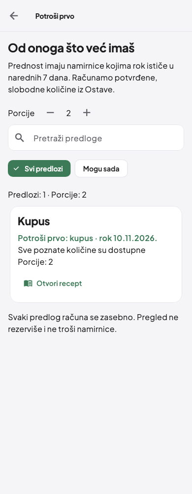
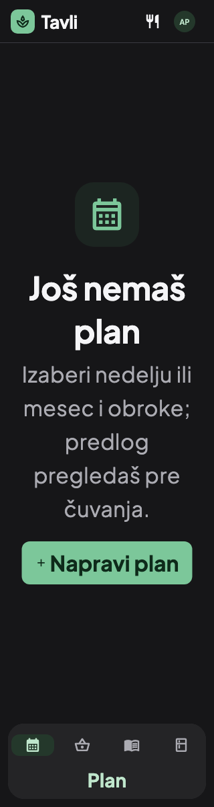

# Tavli — Apple-inspired polish

[Smer dizajna i Apple reference](DESIGN.md) · [Specifikacija](../../specs/016-apple-polish/spec.md)

Promena objedinjuje postojeći sistem tema: neutralniji Bosiljak, Apple sistemski
font na macOS/iOS, mirniji naslovi, doslednije kontrole i zaobljenja, jasnija
bočna navigacija i odvojena donja navigacija na telefonu. Na širem ekranu traka
prikazuje naziv sekcije, na telefonu Tavli brend. Sve tri teme ostaju dostupne.

Prazna stanja dobijaju kontrolisan vizuelni fokus i kratak reveal. Postojeće
ilustracije i animacije su zadržane, a Reduce Motion prikazuje završno stanje
odmah. Profil, prijava, čuvanje podataka, Keep Screen On i funkcije nisu menjani.

## Verifikacija

- Samostalna 016 grana iz origin/main: **574 testa prolaze**, analiza bez nalaza.
- Zajednička verzija prethodnih izmena: **641 test prolazi**, analiza bez nalaza.
- 320/390/768/1024/1440 px, tri tamne teme i tekst 2×.
- Native macOS debug build sa lokalnom konfiguracijom prolazi. Aplikacija je
  ponovo otvorena i vizuelno pregledana, sa očuvanom lokalnom prijavom.
- Proveren je povratak na tačan naslov sekcije posle promene teme u Profilu.
- Provereni izbor taba, Plan/Nabavka/Recepti/Ostava i Potroši prvo, unos i promena
  podataka, forme, provera sastojaka i već postojeći tokovi prijave/čuvanja.
- Dva postojeća testa prate isti scenario i iste provere, uz skrolovanje do
  kategorije/prvog obroka koji sada mogu biti ispod početnog prikaza na telefonu.
  Poslovne provere nisu uklanjane ili oslabljene.
- Nova provera potvrđuje sistemski Cupertino font na Apple platformama i trenutno
  vidljiv sadržaj bez aktivnog tickera kada je Reduce Motion uključen.

Renderi ispod nastali su iz stvarnih Flutter widget testova sa probnim podacima.
U njima tester koristi ugrađeni Plus Jakarta Sans; stvarni macOS build koristi
sistemski Cupertino font. Ovo su prikazi zajedničke verzije sa ranijim granama,
a ne tvrdnja da su te grane već spojene u main.

## Desktop

## Telefon

| Recepti | Ostava | Potroši prvo |
| --- | --- | --- |
|  |  |  |

## Tamna tema i tekst 2×

## Integracija

016 je nezavisna grana iz origin/main. Pri zajedničkom pregledu zadržati 016
HomeShell, TavliBrand (isti `compact` API), temu i TabAppBar, uz postojeći import
i akciju UseFirstButton iz 014. Ostali prethodni ekrani, rute i repozitorijumi
ostaju uključeni. Izolovani worktree je `/tmp/tavli-integration-014`.

GitHub CI i merge čekaju rešavanje prethodno potvrđene naplate/limita naloga.
