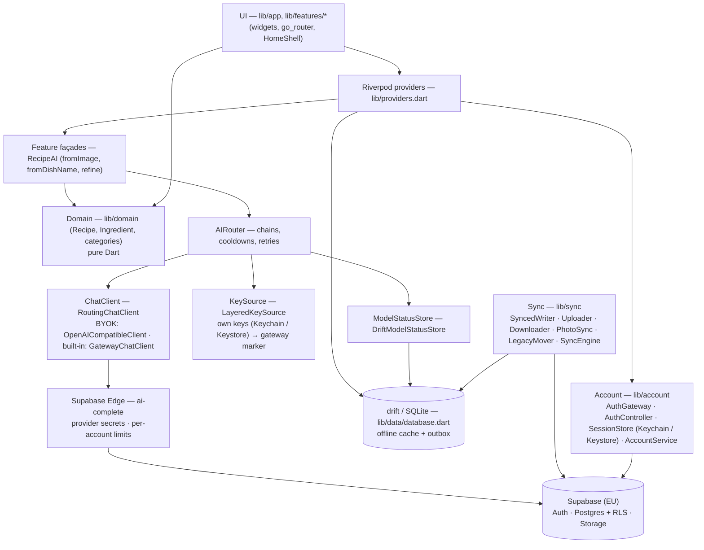
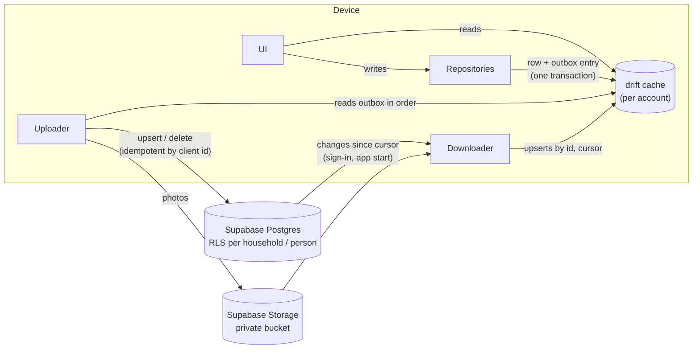
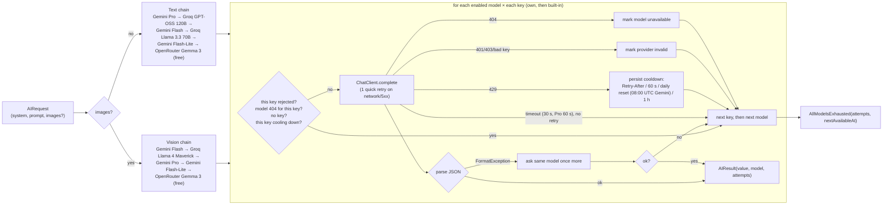

# Tavli architecture

Tavli requires an account. All user data is stored on Supabase (EU region)
under the account; the local drift database is the offline cache the UI reads
from. Spec, plan and decisions: `specs/006-account-login/` (account, server
storage, outbox; research R1–R15).

## Layers

- **UI** reads state through Riverpod and never calls `ChatClient` or providers directly.
- **Domain** is pure Dart; `Recipe.fromAiJson` throws `FormatException` on bad AI output.
- **Data**: one drift database (`tavli`) with tables for recipes, recipe versions,
  pantry, shopping lists/items, meal plans/entries, ratings, user profile,
  app settings and model status. Lists inside rows (ingredients, steps, meal
  types) are stored as JSON text. User-data tables are a cache of the server
  (see "Account and server storage"); app settings (theme) and model status stay
  device-only.
- **Recipes** (spec 003): `RecipeRepository` (`lib/data/recipe_repository.dart`)
  owns recipe rows and versions. Every change (AI, manual, restore) stores the
  *previous* state in `RecipeVersions` with `changeKind`/`instruction`/`changedBy`
  (max 30 per recipe); undo applies and deletes the newest version, restore keeps
  the current state as a new version. Photos are downscaled to JPEG (≤ 1600 px)
  in an isolate and stored as files under `<documents>/recipe_photos/`; the DB
  keeps the relative path (`RecipePhotoStore`).

## Account and server storage (006a)

- **Sign-in**: passwordless email with a 6-digit code (006a); Apple and Google
  (006b). `SupabaseAuthGateway` (pure-Dart `supabase` client, injectable
  `http.Client`) maps every failure to a Serbian message (`authErrorText`).
  The session JSON lives only in Keychain / Keystore (`SessionStore`, key
  `auth_session`) and is renewed automatically; the app starts offline from the
  stored session and the cached `Accounts` row. `AuthController` states:
  `Starting`, `SignedOut(reason)`, `CodeSent`, `NeedsName`, `SignedIn`.
- **Ownership**: at sign-up the `auth.users` trigger creates a profile, a
  personal household ("Moje domaćinstvo") and an owner membership. Household data (recipes,
  versions, photos, shopping lists, pantry, meal plans) belongs to a household;
  personal data (profile, ratings, preferences) belongs to the person.
- **Writes**: repositories write the drift row and an outbox entry in one
  transaction (`SyncedWriter`); ids are client-generated (`newId()`, UUID v4)
  so retries never duplicate. The outbox holds identities, not snapshots; the
  payload is read at send time. `Uploader` sends in order, batching up to 100
  consecutive entries of one entity and kind, row by row when a batch is
  rejected; a permanently rejected entry is parked and reported, it does not
  block the rest. Photos go after data and never hold it up. `SyncEngine`
  pushes on sign-in, start, resume and 1 s after each local change, retrying
  offline after 5 s, 10 s, then every 30 s; Profil shows the save state.
- **Reads**: the UI only reads drift. On sign-in the account's data is
  downloaded (`Downloader`: pages of 500 by `(updated_at, id)`, cursor per
  entity saved per page, 60 s overlap); on app start (and foreground after
  ≥ 15 min) only changes since the cursor are fetched. Rows with a local change
  not yet on the server are not overwritten. Missing photos follow
  (`PhotoSync`, 4 at a time). Until 009 the last write to reach the server wins
  per record; deletes are real `DELETE`s that leave a tombstone in `deletions`,
  and a tombstone makes later inserts of that id (or its children) a no-op, so
  deletion wins over edits.
- **Per-account cache**: cached rows carry `householdId` / `userId` and every
  repository query filters by the active `AccountScope`; sign-out removes only
  the session (data stays on the server and in the cache, hidden), another
  account sees only its own data. Data that predates accounts (scope `null`) is
  moved once, in one SQLite transaction, into the first account that signs in
  on the device (`LegacyMover`, record `AppSettings['legacy_move']`).
- **Delete account**: Edge Function `delete-account` (service role only in the
  function environment) removes the household's photos through the Storage
  API, calls `public.delete_account_data(uid)` and deletes the auth user; only
  after HTTP 200 does the app wipe the account's cache, outbox, cursors, photos
  and own AI keys. Theme and model cooldowns stay on the device.
- **Security**: RLS on every table (person or household membership through
  `private.is_member`), explicit `GRANT`s to `authenticated`, nothing for
  `anon`, new tables not auto-exposed; private bucket `recipe-photos`
  (`{household_id}/{file}.jpg`) with the same rule. Migrations are in
  `supabase/migrations/`; pgTAP tests in `supabase/tests/` (catalog, two-account
  isolation for every table and storage, deletions, account deletion) run with
  `supabase test db`. Flutter tests use an in-memory fake backend
  (`test/helpers/fake_backend.dart`) and `MockClient` for the Supabase adapters.
- **Later**: 008 adds invites and roles; 009 adds realtime updates between
  household members and conflict handling for simultaneous edits.

## Food catalog (036)

- **Tables**: `foods`, `food_aliases`, `food_conversions`, `food_allergens` and
  the reference table `allergens` (EU 14). `household_id null` is the shared
  catalog: reference data without personal data, readable by every signed-in
  user, writable only by migrations (constitution exception for reference
  data). Rows with a `household_id` are the household's own foods, visible and
  editable only by members. An own alias may never shadow a shared one
  (`food_alias_taken`).
- **Ids, text for display**: a recipe ingredient stores `foodId` in its JSON,
  `pantry_items` and `shopping_items` a `food_id` column; the typed text stays
  as written. Repositories fill a missing id by exact alias after
  normalization (never overwriting a person's choice); otherwise the row is
  "Nepotvrđeno" and the person picks or creates a food
  (`lib/features/foods/`). AI never writes to the catalog; it only suggests a
  draft (`suggestFood`) that a person confirms.
- **Shared catalog data**: `supabase/catalog/foods.csv` (reviewed by the team)
  → `scripts/catalog_seed.dart` → seed migration. Existing rows were mapped
  once on the server (`private.map_food_ids()`, exact shared alias only) and
  reach devices through the normal download.
- **Demand dictionary v3 (043)**: snapshots approved from 043 on add kitchen
  measures to v2 (čaša 200 ml, šolja 250 ml, kašika 15 ml, kašičica 5 ml are
  approximate and make the summed amount carry `~`; dl and dkg are exact).
  v0–v2 stay frozen; older plans and stock are not re-summed. The flag is
  stored per contribution and shopping item (`approximate`).
- **Demand dictionary v2**: snapshots approved after 036 use
  `dictionaryVersion: 2`: identity `food:<id>` when the ingredient has a food,
  with food conversions (e.g. 1 čen garlic = 5 g) frozen in the snapshot.
  v0/v1 snapshots are never recomputed differently (golden test).
- **Food nutrition (045)**: shared catalog foods carry kcal, protein, fat and
  carbs per 100 g with a source (`usda-sr-legacy-2018-04`, FDC id); unknown stays
  null, never zero (`Food.nutrition`). Values are generated from USDA source
  files, never typed or produced by AI.
  Incompatible food-state mappings were withdrawn in a new migration: ground
  coffee/tea versus brewed drinks, coconut flour versus raw coconut, dry bread
  crumbs versus soft bread and unbaked versus baked puff pastry. These five foods
  remain unknown until a matching source is reviewed (161/171 foods covered).
- **Recipe nutrition (046)**: `recipeNutritionPerServing` (domain) turns ingredient
  grams × food nutrition per 100 g into kcal and macros per serving, with coverage
  ("counted for 7 of 8 ingredients"). Grams come from food conversions, mass units,
  `unit_grams` (piece weight for `kom`, density for `ml`, from USDA portions).
  Ingredients that cannot be converted stay out of the total; nothing is shown when
  none is covered.
- **Allergens**: shown only from confirmed foods ("Sadrži: …"), with
  "Podaci o alergenima nisu potpuni." while any ingredient is unconfirmed; the
  app never claims a recipe is allergen-free.
- **Personal export** (format 2) includes the household's own foods with
  aliases, conversions and allergens, not the shared catalog.
- **Personal export** (format 3, 038) covers every household table of the
  active household (recipe versions, week templates, cook-soon queue,
  preferences, shopping sources, contributions, supply allocations), the
  person's own ratings for that household's recipes, their taste profile and
  their own membership. It never includes other members (names, emails), other
  households, app settings, model status, the outbox or sync cursors.
- **Allergies per person** (039): `member_allergies`, one row per person and
  household (`id` = `household:user`), readable by every member and written
  only by its person (RLS). Leaving or being removed deletes the row
  (trigger on `household_members`). The union of all members applies to every
  meal: `checkAllergens` (catalog codes + whole-word match for custom terms)
  guards AI recipes. By name and chat edit: one retry with the hits, then
  `AllergenViolation` (chat edit rejects only new allergens). Meal plan: library
  recipes with an allergen are not offered; new summaries retry once, then the
  slots stay empty. Photo and link imports are not rejected; preview, form and
  detail show "Sadrži alergen člana" and, independently when needed,
  "Nepotvrđeno, proveri alergene". Late legacy allergy writes from older clients
  or pending outboxes join the household union for prompts, guards and warnings;
  they are not assigned to an arbitrary person's allergy row.
  Personal export format 6 also includes the approximate-quantity flag on shopping items and contributions (043); format 5 added confirmed shopping product selections; format 4 added the person's own allergies.

## Local development backend

`supabase start` in the repo root runs the local stack from
`supabase/config.toml` on ports 5532x (API 55321, DB 55322, Studio 55323, mail
catcher 55324) so it does not clash with other local Supabase projects.
`supabase status` prints the local URL and anon key for your own gitignored
`secrets.json`. Migrations live in `supabase/migrations/`, pgTAP tests in
`supabase/tests/`, the Edge Function in `supabase/functions/delete-account/`,
the Serbian sign-in email in `supabase/templates/`. Sign-in codes arrive in the
mail catcher (Mailpit) at http://127.0.0.1:55324.

## Navigation (current implementation)

`StatefulShellRoute.indexedStack` with five tabs: Recepti, Plan, Ostava,
Kupovina, Profil. `HomeShell` shows a bottom `NavigationBar` below 720 px and a
`NavigationRail` at ≥720 px (extended at ≥1000 px). `/profile/ai-keys` is the
AI keys screen.
A `go_router` redirect (`authRedirect`, refreshed on every auth state change)
sends every route to the sign-in flow (`/sign-in`, then the mandatory name step
`/sign-in/name`) while there is no session or no saved name; the requested
route is kept in `?from=` and opens after sign-in. A banner above the tabs
shows "Čuvam tvoje podatke…" / "Preuzimam tvoje podatke…" during the one-time
move and the first download.

Recipe routes: `/recipes` (list), `/recipes/new/{name,photo,manual}`,
`/recipes/:id` (detail), `/recipes/:id/edit`, `/recipes/:id/chat`. When the
content area is ≥ 840 px wide, `/recipes/:id` shows the list and the recipe side
by side (`RecipeRoute`), otherwise the detail is a full screen.

## Target planning experience (specified, not implemented)

[Product design](product-design.md) and [010](../specs/010-plan-and-shopping/spec.md)
define the future shell: Plan, Nabavka, Recepti, Ostava and a profile avatar.
Plan opens after auth/name gates; "Danas" is a shortcut inside it. Keep existing
recipe, /shopping and /profile deep links, auth lifecycle, sync banners and
wake lock. Historical five-tab behavior remains current until implementation.

Future data flow: UI → Riverpod → MealPlanAI/AIRouter for in-session previews;
approval → account-scoped repositories → local row + outbox transaction → sync.
The UI reads saved plans, shopping and pantry from drift, never the network.

Existing tables are foundations, not a complete planning feature. 010 plans
entry servings/snapshots, exact shopping-period boundaries, preparation source headers, per-source demand,
confirmed supply allocations and receipt provenance. A month may touch six
weeks; its view aggregates canonical weekly rows. A purchase and its pantry
receipt share one supply identity. See
[data model](../specs/010-plan-and-shopping/data-model.md).

Future additions require a drift version bump/migration, generated code, new
SQL migrations with RLS/grants, sync registry/cleanup updates and two-account
tests. No schema or app code is changed by this documentation revision. 008
invitations and 009 realtime are separate; solo planning can precede them. Standalone recipe shopping stores a source
snapshot without inventing a plan or silently saving a library recipe.

## AI router and fallback chains

Key points:

- Chains live in `ChainConfig` (`defaults`), filtered by `enabled` and, for
  vision, `supportsVision`. The config is read through a function so the user
  can change it at runtime.
- For each model the router tries every credential from `KeySource` in order
  (own key, then built-in Tavli key) before moving to the next model.
- Cooldowns and per-day request counts persist in the `ModelStatuses` table
  per (provider, model, key origin) and survive restarts.
- Rejected keys / missing models are remembered in memory per key origin.
  `invalidProviders` reports only rejected *own* keys; `resetProvider`
  (called when the user saves a new key) clears own-key state only.
- Errors thrown by `parse` other than `FormatException`/`TypeError` (e.g.
  `NotARecipeException`) stop the chain and reach the UI.
- `aiErrorText` maps every error to a Serbian message.

## Secrets

Supabase URL and anon key come from the gitignored `secrets.json` (empty
placeholders in `secrets.example.json`); the anon key is public by design and
safe only because of RLS. The service-role key is never in the app or repo.

Keys are entered by the user on the AI keys screen (spec 004): one generic
field, the service is detected from the key prefix (`AIza` Gemini, `gsk_` Groq,
`sk-or-` OpenRouter) or picked by the user, and the key is checked with the
free model-list request before saving. Any number of keys per service is
stored as one JSON list under `api_keys` in `flutter_secure_storage`
(old `api_key_<provider>` entries are migrated on first read). Own keys of a
service are tried in add order, then the built-in key; pauses and rejections
are tracked per key (`keyOrigin` column holds `user:<id>` / `builtIn`). The UI
shows only the last 4 characters. Nothing secret is in the repo.

Built-in Tavli AI (037) uses `GatewayChatClient` and the Supabase Edge Function
`ai-complete`. The server verifies the account, accepts only allowlisted models
and at most 6 MiB, and applies an atomic per-account limit of 20 attempts per
minute and 300 per UTC day before calling a provider. Attempts are counted per
model, including fallback and invalid-JSON retries. Provider keys stay in server
secrets; an expired session (401) is transient to the router. BYOK still goes
directly through `OpenAICompatibleClient` and takes priority.

`builtInKeysFor` supplies gateway markers for signed-in release builds;
build-time provider keys are used only for local development. The earlier
spec 002 `BuiltInKeys.fromEnvironment()` path remains available in debug builds.
The proposed Cloudflare proxy was replaced by the implemented Supabase gateway.

## Themes and animations

Three themes (Bosiljak, Šafran, Borovnica), each light and dark, use bundled Plus Jakarta Sans. Profil → Izgled selects and previews a theme; Profil → Animacije is a debug-only gallery. New installations start in light Bosiljak; saved selections and system mode are preserved. The same theme is applied during account startup and on the sign-in screens.
