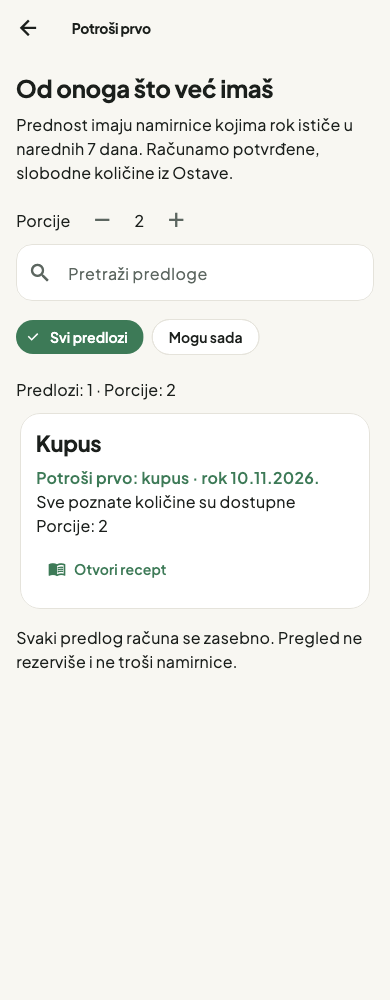
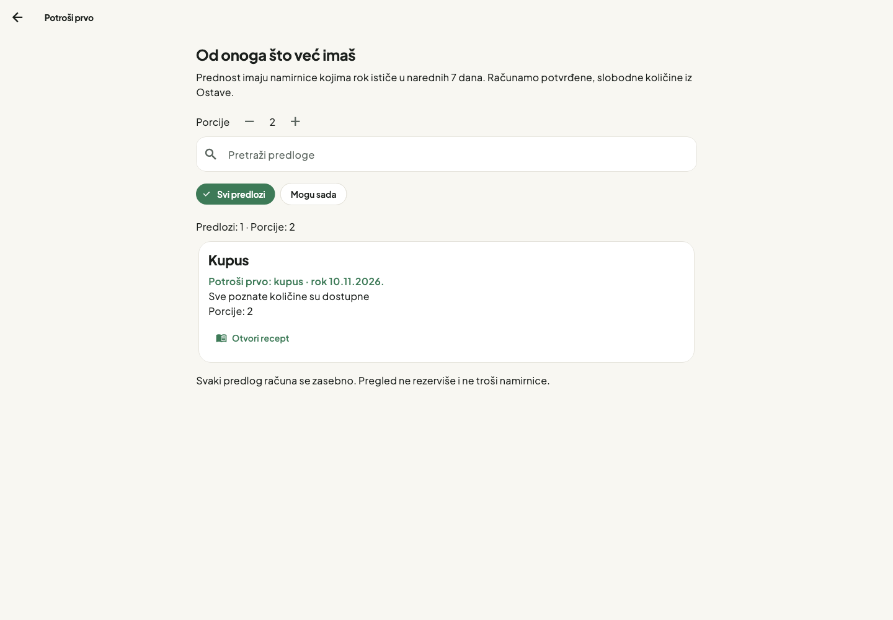

# Potroši prvo

Grana `014-use-first`, spec [014](../../specs/014-use-first/spec.md).
Ulaz: ikonica „Potroši prvo“ u zaglavlju glavnih tabova ili ruta `/use-first`.

Predlozi koriste postojeće recepte, potvrđene zalihe Ostave i njihove slobodne
količine posle rezervacija. Partije sa bližim rokom koriste se prve. Namirnice
koje se stvarno koriste i ističu u narednih sedam kalendarskih dana daju
prioritet receptu. Istekle i nepotvrđene zalihe ne povećavaju pokriće.

Porcije (1–20) skaliraju iste postojeće sastojke. Filter „Mogu sada“ prikazuje
samo recepte sa svim poznatim i pokrivenim količinama. Ostali prikazuju šta
nedostaje ili čiju količinu treba proveriti. Svaki recept je zasebna mogućnost;
prikaz ništa ne rezerviše, ne troši i ne upisuje u Nabavku.

„Otvori recept“ otvara postojeći recept u njegovom izvornom obliku, sa njegovim
osnovnim porcijama i postojećim tokom provere sastojaka. Izabrane porcije na
ovom ekranu služe proceni predloga; ne menjaju sačuvani recept.

Podaci dolaze iz iste lokalne Drift baze i osvežavaju se na promenu recepata,
Ostave ili rezervacija. Vreme se proverava jednom u minutu i pri povratku u
aplikaciju. Nema AI/mrežnog poziva za izračunavanje predloga. Postojeća prijava,
izolacija domaćinstva, outbox i sinhronizacija ostaju izvor podataka.

## Poreklo

Adaptiran je princip Grocy Due Score iz preuzete MIT reference. SQL nije
uveden kao nova baza, a njihova težina za istekle namirnice nije preuzeta.
[Pinned izvor i razlike](../../third_party/grocy/UPSTREAM.md),
[originalna licenca](../../third_party/grocy/LICENSE.md).
Za proračune se koriste Tavli `demandFor`, `normalizeUnit` i `allocateSupply`.
Povezivanje naziva prati postojeći `ingredientKey`: razmaci/veličina slova,
bez izmišljenih sinonima i bez pretvaranja mase u zapreminu.

## Provera

- Samostalna grana: **584 testa prolaze**, `flutter analyze` bez nalaza.
- Novi testovi: 8 domenskih, 1 repository i 13 widget testova.
- Repository test proverava izolaciju domaćinstva, kanonski identitet kupovine,
  rezervacije, osvežavanje posle promene rezervacije i odsustvo outbox upisa.
- Widget testovi: žive promene količina, prioritet, 500 g × 3/2 − 500 g = 250 g
  manjka, filter, pretraga, postojeći recept, prijava, error/retry, prazna stanja.
- Širine 320/390/768/1024/1440 i tri tamne teme sa tekstom 2×; stvarni Flutter
  renderi ispod, vizuelno pregledani. Prikaz koristi postojeću temu aplikacije.
- Native macOS debug build: **prolazi**, Xcode 27.2 (27B52), Flutter 3.47.9.
  Prolaze i samostalna 014 grana i zajednička 011 + 012 + 013 + 014 verzija.
- Aktivni `xcode-select` put pokazuje na Command Line Tools. Puna instalacija
  Xcode-a postoji; build je uspeo sa lokalnim `DEVELOPER_DIR` izborom ispod.
  Nije bilo potrebe za promenom koda, generisanih fajlova ili globalnih postavki.
- GitHub CI je blokiran **naplatom naloga**, ne workflow sintaksom. Run
  [42684051970](https://github.com/umilutinovic25-hash/tavli-next/actions/runs/42684051970)
  u Annotations navodi neuspelu naplatu ili potrebu za većim spending limitom.
  Poslovi zato nisu ni pokrenuti. Vlasnik je odložio sređivanje naplate.
- PR ostaje draft i nije spojen u `main`. Posle sređivanja Billing-a treba
  pokrenuti novi CI run i sačekati zelen rezultat; lokalni prolaz ne zamenjuje CI.

Komanda koja je uspešno izgradila obe verzije:

```sh
DEVELOPER_DIR=/Applications/Xcode.app/Contents/Developer flutter build macos --debug
```

Debug aplikacija je u `build/macos/Build/Products/Debug/tavli.app` svakog
worktree-a. Build je urađen bez čitanja ili unošenja stvarnih korisničkih ključeva.

### Zajednički pregled 011 + 012 + 013 + 014

Grana 014 je iz `origin/main`, po pravilima projekta. CRUD Ostave ostaje u
[PR #3](https://github.com/umilutinovic25-hash/tavli-next/pull/3), frontend u
[PR #2](https://github.com/umilutinovic25-hash/tavli-next/pull/2), mreža recepata u
[PR #4](https://github.com/umilutinovic25-hash/tavli-next/pull/4).

**Zajednički rezultat: 629 testova prolazi, `flutter analyze` bez nalaza.**
Uključuje ceo tok unos namirnice → predlog po roku → postojeći recept.

Izolovani zajednički worktree: `/tmp/tavli-integration-014`. Pri spajanju u
`router.dart` zadržati import i rute Ostave 012, dodati import/rutu use-first,
a uklonjene placeholder importe ne vraćati. U `tab_app_bar.dart` zadržati
`TavliBrand`, novu prečicu i omotač `FittedBox` iz 014 za uski prozor/tekst 2×.
Repository i njegovi testovi spajaju se bez konflikata.

Regresiona provera pokriva i prelazak tab → predlozi → drugi tab. Otvaranje
postojećeg recepta koristi `go`, da stateful shell ne dobije dupli ključ stranice.

Dodatni test „Ostava unos → Potroši prvo → postojeći recept“ sačuvan je kao
[reproduktivni primer](../../specs/014-use-first/pantry_to_suggestion_test.dart.txt).
Posle integracije kopirati ga u
`test/features/use_first/pantry_to_suggestion_test.dart` i pokrenuti testove.
Ne uključuje se u samostalnu 014 zbirku jer koristi CRUD koji pripada 012.

## Stvarni Flutter prikaz




